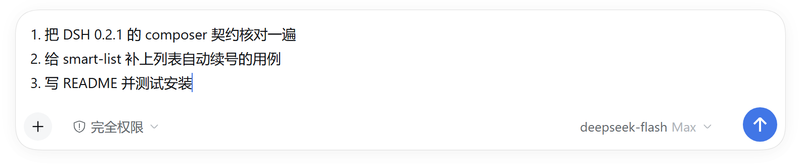

# dsh-tweaks

给 **DSH（DeepSeek Harness）** 装的一套小插件：装上就直接用，不用改 DSH 本身。各插件互相独立，按需安装。

> 适配 DSH **0.2.1**；最低支持 **0.2.0**。

---

## 目录

- [prompt-history —— 输入框里的历史提示词](#prompt-history--输入框里的历史提示词)
- [smart-list —— 输入框里的列表自动续号](#smart-list--输入框里的列表自动续号)
- [git-bash-terminal-tool —— 可将 Windows 环境下的终端工具替换为 Git Bash](#git-bash-terminal-tool--可将-windows-环境下的终端工具替换为-git-bash)
- [已停止维护的插件](#已停止维护的插件)
- [安装](#安装)

---

## prompt-history —— 输入框里的历史提示词

**它能做什么**

在会话输入框里按 ↑ / ↓，翻出这个会话里之前发过的提示词，像终端里翻命令历史一样。翻到想要的，改一改就能直接发。

**怎么用**

1. 点进输入框，确保里面是空的。
2. 按 **↑**：自动填上你上一次发过的提示词；再按 **↑** 继续往更早翻。
3. 按 **↓** 往回翻；翻过最新一条时，输入框恢复成你按 ↑ 之前的内容。
4. 翻到想要的 → 直接编辑，或者回车发送。

翻的过程中，输入框右上角会显示 `↑↓ 历史 3/12`，告诉你现在翻到第几条：


> 只有输入框为空时才会接管 ↑，不会跟 `/` 命令菜单、`@` 引用菜单打架；历史只属于当前会话，刷新页面也还在。

详细说明见 [`plugins/prompt-history/README.md`](./plugins/prompt-history/README.md)。

---

## smart-list —— 输入框里的列表自动续号

**它能做什么**

在输入框里写「1. … 2. … 3. …」这类列表时，按 **Shift+Enter** 换行后自动补上下一个编号，不用自己敲 `2.`、`3.`。

**怎么用**

1. 输入第一条：`1. 第一件事`（也支持 `1) `、`1、`、`1）`，以及 `- ` / `* ` / `+ ` / `• ` 无序列表）。
2. 按 **Shift+Enter**：新的一行自动出现 `2. `，直接接着写第二项。
3. 继续 Shift+Enter 会依次出现 `3. `、`4. `……写完正常按 Enter 发送。

```
1. 把 DSH 0.2.1 的契约核对一遍
2. 给 smart-list 补上列表自动续号的用例
3. 写 README 并测试安装
```



> 只接管 **Shift+Enter**（普通 Enter 仍是发送）；输入法组合期、有选区、`@` / `/` 菜单都不受影响。
> 缩进、前导零都会保留；空条目（`2. ` 后面没内容）只换行、不再续号。
>
> 和 Codex / ChatGPT 的「列表块」不同：那边是富文本列表 marker，DSH 的 composer 是
> 普通段落 + 软换行，本插件用纯文本插入 `换行 + 下一个标记` 达到同样的输入体验，
> 不改文档结构、不碰 `@` 引用 chip。详细原理与边界见
> [`plugins/smart-list/README.md`](./plugins/smart-list/README.md)。

---

## git-bash-terminal-tool —— 可将 Windows 环境下的终端工具替换为 Git Bash

> Windows 专用（非 Windows 平台不会挂载）；最低支持 DSH **0.2.0**。

**它能做什么**

Windows 上 DSH 默认让模型用 PowerShell（工具名 `pwsh`）执行命令。这个插件把它换成 **Git Bash**，
并且**对所有 preset 生效**（standard / ptc / cordis / minimal）——不改 DSH 源码，也不改任何 preset 文件。

- 模型看到的工具叫 `bash`，描述是 Git Bash 方言（POSIX 路径、`$VAR`）；`pwsh` 从工具目录里消失；
- system prompt 里的 PowerShell 段被压掉，换成 bash 那段；
- **会话当前目录**：模型用 `working_directory` 工具切目录后，命令与终端卡片都跟随新目录（沙箱授权仍按原始项目，不随 `cd` 扩大）；
- 终端卡片、退出码 pill、后台任务、沙箱拒绝与升级，表现与官方一致。

**怎么用**

1. 打开 **设置 → 通用 → 终端工具**（插件只在 Windows 上挂载，其他平台这一行根本不存在）。
   默认是 **PowerShell（pwsh）**，这里只有两个工具选项 —— 插件**不会自动替你选**。
2. 点 **Git Bash（bash）**：这时才出现「Git Bash 路径」与 **自动发现** 按钮（切回 pwsh 就又收起来）。
3. 点 **自动发现**：扫描 Git for Windows / MSYS2 / Cygwin，把**第一个可用** `bash.exe` 填进路径栏并记住它；
   找到多条 git 路径时，路径栏会变成**下拉列表**，重启 DSH 后依然可选。
4. **开一个新会话**即生效。


> 不用 WSL 的 `bash`：`System32` / `WindowsApps` 下的 `bash.exe` 会被硬排除。
> 且**会话沙箱必须是 `danger-full-access`**，受限模式下 Git Bash 起不来。

详细说明（含排障与已知限制）见 [`plugins/git-bash-terminal-tool/README.md`](./plugins/git-bash-terminal-tool/README.md)。

---

## 已停止维护的插件

下面两个插件已**停止维护**：代码与各自的 README 已从本仓库移除（历史可在 `git log` 中查看），
npm 上已发布的旧版本不再更新，也不在插件市场收录。此处保留说明，让后来者了解它们曾经提供什么、
为什么停维护。

### model-capabilities —— 已停止维护（最后支持 DSH 0.2.1）

原功能：在 **设置 → 模型** 的模型行「容量」展开区补上官方没有的控件 ——
第三方网关 `llm-pi-ai` 且官方未渲染推理控件的模型行上的**思考强度**编辑器（OpenAI / Anthropic 协议预置档位），
以及「上下文窗口 / 最大输出」的 **1M / 128K 容量快捷填入**。

停维护原因：DSH 0.2.1 官方已原生提供模型行的输入类型控件与 hand-declared 路由的推理等级控件，
插件剩余增量不足。

### turn-file-revert —— 已停止维护（最后支持 DSH 0.2.0）

原功能：每轮对话结束在回合末尾补一行「本轮改动统计 + 撤回全部修改 / 重新应用修改」——
统计这一轮加了多少行、删了多少行、改了几个文件，并能把这一轮改过的文件一键还原/重新应用。

停维护原因：官方 DSH 0.2.x 已内置回合改动卡片与逐文件 diff 复核能力。

---

## 安装

各插件互相独立，装需要的那个即可。目录名即上文的 `<name>`（如 `prompt-history`），npm 包名为 `dsh-tweaks-<name>`。

```
# 从 npm 安装（推荐）
npx @deepseek-ai/dsh plugin --profile web add dsh-tweaks-<name>

# 或从本仓库源码安装
npx @deepseek-ai/dsh plugin --profile web add "<仓库目录>/plugins/<name>"
```

安装完成后重启 DSH，并在浏览器中强制刷新（`Ctrl + Shift + R`）。

> 纯浏览器半区的插件（如 `smart-list`）安装后刷新浏览器即可，不需要重启 DSH 宿主。
>
> `web` 为 DSH 的 profile 名称；profile 配置在 DSH 主目录下的 `profiles/` 里：默认即用户目录下的
> `~/.dsh`（Windows 为 `%USERPROFILE%\.dsh`），若设置了 `DSH_HOME` 则以其为准。

---

开发约定、DSH 契约与常见坑见 [AGENTS.md](./AGENTS.md)。
